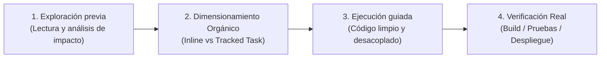

# Metodología ODD (Organic Driven Development)
## Proyecto: Mensajería UNCP IA

Este proyecto adopta **Organic Driven Development (ODD)** como metodología de ingeniería de software asistida por Inteligencia Artificial para el desarrollo de la aplicación móvil accesible y su backend en la nube.

---

### Principios Fundamentales

1. **Exploración previa obligatoria (*Zero Guesswork*):**
   - Antes de modificar código, se inspecciona el estado real del repositorio, la base de datos (PostgreSQL), la API (FastAPI) y los componentes de Compose.
   - Prohibido suponer rutas, nombres de símbolos o credenciales.

2. **Dimensionamiento Orgánico (*Sizing*):**
   - **Nivel 1: Tareas Directas (*Inline*):**
     - Cambios estéticos, textos, refactorizaciones locales o ajustes de parámetros simples.
     - Se ejecutan directamente con verificación inmediata sin generar burocracia documental innecesaria.
   - **Nivel 2: Tareas Complejas (*Tracked*):**
     - Modificaciones que involucran sincronización entre cliente y servidor, cambios de arquitectura, seguridad (Tríada CIA) o nuevos módulos interactivos.
     - Se crea un archivo de seguimiento en `odd/tasks/TASK_<nombre>.md` con:
       * **Objetivo principal**
       * **Criterios de Aceptación**
       * **Checklist de ejecución viva**
       * **Registro de verificación**

3. **Verificación Real y Proporcional (*Evidence-Based*):**
   - Ninguna tarea se da por concluida sin evidencia de verificación ejecutable:
     - Compilación estricta con `./gradlew assembleDebug` (0 errores).
     - Validación en dispositivo físico (Xiaomi Redmi / Android).
     - Pruebas de endpoints REST y consistencia en PostgreSQL.

4. **Integración con la Investigación Académica:**
   - ODD sirve como sustento metodológico para la tesis/investigación: documenta cómo la ingeniería con agentes de IA puede mantener rigor técnico, accesibilidad universal y seguridad sin caer en el *vibe coding* caótico ni en la lentitud burocrática del SDD tradicional.
